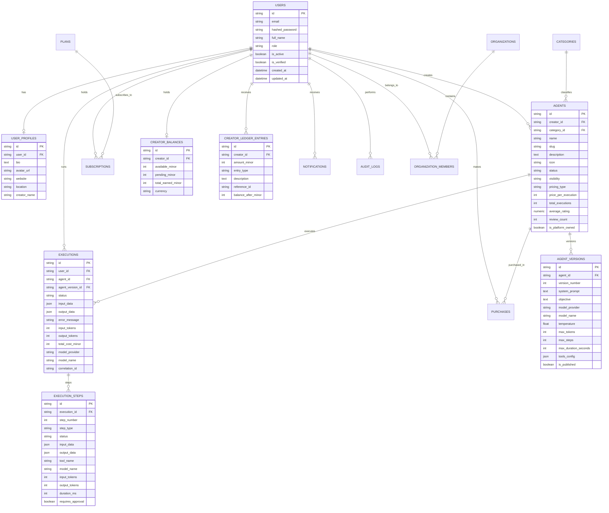

# AgentHub Database Architecture & Entity-Relationship Diagram

All tables use UUID v4 string primary keys and UTC timestamps. Financial values are strictly stored as integers representing minor currency units (cents / paise) to prevent floating point inaccuracies.

